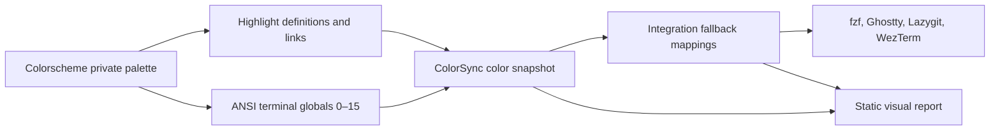
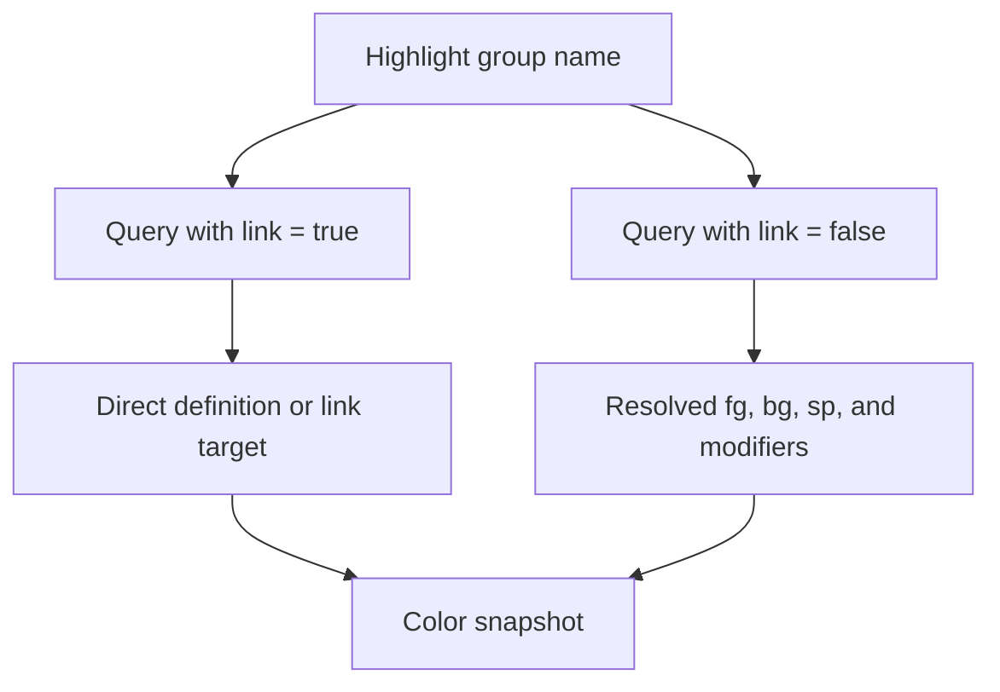
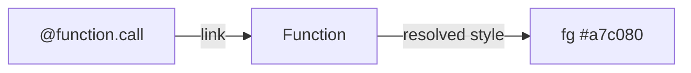
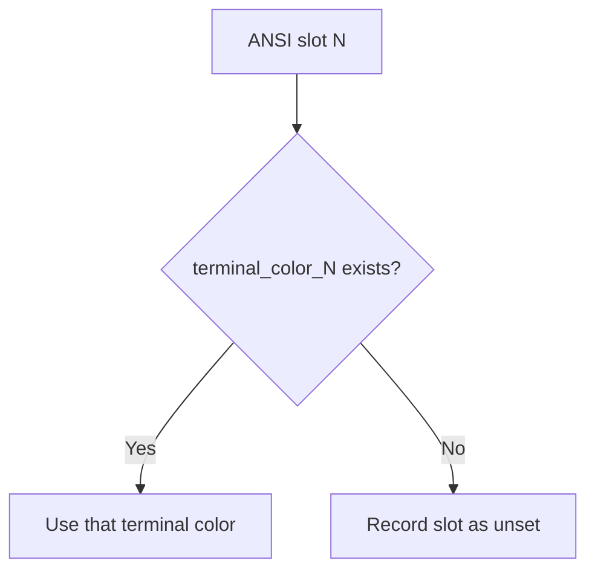
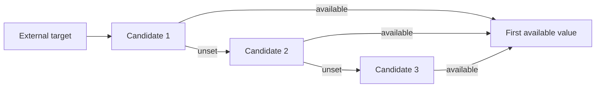
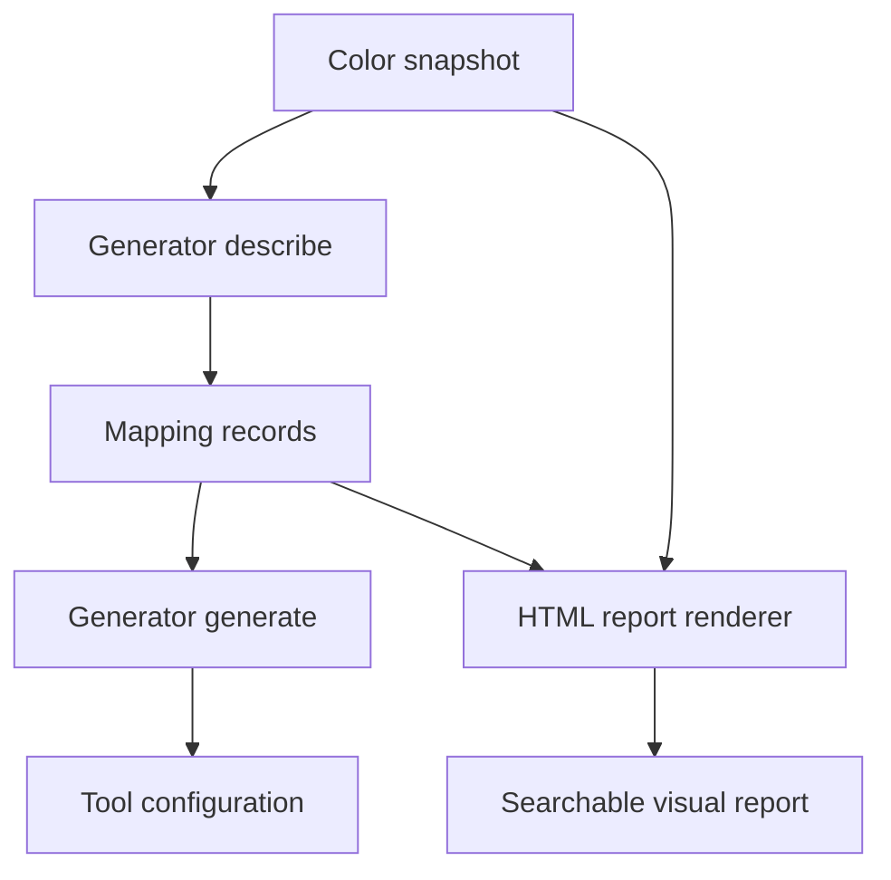
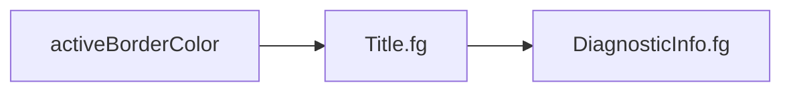

# ColorSync Color Model

This guide explains which colors Neovim exposes, how ColorSync retrieves them, and how those values become themes for external tools.

## The Short Version

ColorSync can read two standardized color surfaces from Neovim:

1. **Highlight groups** describe semantic roles such as normal text, selections, errors, and functions.
2. **Terminal colors** provide the 16 ANSI colors used by terminal applications.

A colorscheme's own private palette is not standardized. Names such as `bg0`, `red`, or `aqua` exist only inside that colorscheme's implementation and cannot be retrieved generically.



The two arrows from the private palette are important: highlights and ANSI colors are defined in parallel. Neovim does not derive one from the other, and ColorSync does not either. A slot the colorscheme leaves unset stays unset.

## Vocabulary

| Term | Meaning | Example |
|---|---|---|
| Private palette | Internal names chosen by one colorscheme | `bg0`, `orange`, `aqua` |
| Highlight group | A semantic Neovim style | `Normal`, `Visual`, `DiagnosticError`, `@function` |
| Highlight link | A group that inherits another group's style | `@function.call` → `Function` |
| Resolved highlight | Final colors and modifiers after following links | `fg = #a7c080`, `bold = true` |
| ANSI terminal palette | Sixteen conventional terminal color slots | `terminal_color_0` through `terminal_color_15` |
| Integration target | A tool-specific theme setting | Lazygit's `activeBorderColor` |

## How Highlights Are Retrieved

[`lua/colorsync/color_data.lua`](../lua/colorsync/color_data.lua) asks Neovim for every registered highlight name using:

```lua
vim.fn.getcompletion('', 'highlight')
```

It then makes two API calls for every group:

```lua
vim.api.nvim_get_hl(0, { name = name, link = true })
vim.api.nvim_get_hl(0, { name = name, link = false })
```



- `link = true` preserves a link such as `@function.call → Function`.
- `link = false` follows that link and returns the final style generators can use.
- `fg`, `bg`, and `sp` numeric RGB values are normalized to lowercase `#rrggbb`.
- Modifiers such as `bold`, `italic`, `underline`, `reverse`, and `blend` remain attributes rather than being treated as colors.

ColorSync stores both views because they answer different questions:

- Generators need the **resolved value**.
- The report needs the **original relationship** to explain where that value came from.

### Example Link Resolution



The exact groups and values depend on the active colorscheme and installed plugins.

## How the ANSI Palette Is Retrieved

ColorSync reads the globals set by the active colorscheme and nothing else:

```lua
vim.g.terminal_color_0
vim.g.terminal_color_1
-- through terminal_color_15
```



A missing global stays nil. ColorSync does not borrow a highlight such as `Function.fg` to fill the gap: highlight groups do not have stable ANSI roles across colorschemes. Generators that want a semantic color ask for the highlight directly, and they skip an unset ANSI candidate.

Each entry records its value and provenance. The visual report labels every slot as explicit or unset, and it still shows the conventional name (black, red, green, and so on) so the index is readable.

### Terminal Palette Lifecycle

The terminal color globals are mutable session state. `:colorscheme` does not clear them automatically, so a colorscheme that does not set all 16 slots can inherit values left by the previously loaded scheme. ColorSync can tell whether a global exists, but it cannot tell which colorscheme assigned it; a stale value therefore looks explicit.

Clean Neovim and the built-in `default` colorscheme leave these globals unset. Neovim then uses an internal fallback palette when a terminal buffer opens. That fallback is not exposed through `vim.g.terminal_color_N` or another public palette API, so ColorSync cannot capture it.

Neovim reads the globals during `TermOpen`. Changing a colorscheme does not recolor terminal buffers that are already open; a newly opened terminal uses the values present at that time.

## The Captured Snapshot

`require('colorsync.color_data').capture()` returns one snapshot:

```text
colorscheme
highlights
  GroupName
    resolved attributes
highlight_definitions
  GroupName
    direct attributes or link
highlight_names
terminal_palette
  indexes 0 through 15
terminal_sources
  explicit or unset provenance
```

[`lua/colorsync/init.lua`](../lua/colorsync/init.lua) captures this data once per synchronization and passes the resolved highlights and terminal palette to every generator.

## How Integration Mappings Work

[`lua/colorsync/mapping.lua`](../lua/colorsync/mapping.lua) provides three kinds of candidates:

| Candidate | Meaning |
|---|---|
| Highlight | A group attribute such as `Visual.bg` |
| Terminal | An ANSI slot such as `terminal_color_4` |
| Literal | A tool keyword or final hardcoded fallback |

Each external target has an ordered candidate list. The first candidate with a value wins.



Every generator exposes the same two operations:

- `describe(highlights, terminal_palette)` returns targets, semantic roles, candidates, selected sources, values, and modifiers.
- `generate(highlights, terminal_palette)` formats those described mappings for the external tool.



This shared source of truth prevents the report from claiming one mapping while the generated configuration uses another.

## Current Integration Strategies

| Integration | Main sources | Examples |
|---|---|---|
| fzf | `Normal` plus ANSI colors | foreground from `Normal.fg`, prompt from ANSI green |
| Ghostty | `Normal`, `Cursor`, `Visual`, and all ANSI slots | terminal background, cursor colors, complete palette |
| WezTerm | `Normal`, `Cursor`, `Visual`, and all ANSI slots | Lua color table with ANSI and bright arrays |
| Lazygit | Semantic UI, diagnostic, diff, and selection highlights | borders, selected lines, commit markers, unstaged changes |

### Lazygit Example

Lazygit's active border uses the first available candidate:



Lazygit mappings copy compatible attributes without changing them. Commit marker text uses `Normal.fg`; backgrounds use only `DiffAdd.bg` or `DiffChange.bg`. If a suitable attribute is absent, ColorSync omits that property and lets Lazygit use its default instead of repurposing a foreground color as a background.

## Generate and Use the Visual Report

Generate a report for an installed colorscheme:

```sh
just color-report everforest
```

Open the resulting file:

```sh
open build/colorsync-everforest.html
```

Choose a custom output path with the second argument:

```sh
just color-report tokyonight /tmp/tokyonight-colors.html
```

The report contains:

- the four-layer color model;
- all 16 ANSI swatches and their provenance;
- every highlight group with search and category filters;
- direct links and fully resolved colors;
- style modifiers and rendered previews;
- all integration targets, selected sources, fallback chains, and final swatches.

The report is self-contained: its CSS and JavaScript are embedded, and it does not load external assets.

## File Guide

| File | Responsibility |
|---|---|
| [`lua/colorsync/color_data.lua`](../lua/colorsync/color_data.lua) | Capture and normalize highlights and ANSI colors |
| [`lua/colorsync/mapping.lua`](../lua/colorsync/mapping.lua) | Represent fallback candidates and select values |
| [`lua/colorsync/generators/`](../lua/colorsync/generators/) | Describe mappings and format external configurations |
| [`lua/colorsync/report.lua`](../lua/colorsync/report.lua) | Render the standalone visual report |
| [`scripts/generate-color-report.lua`](../scripts/generate-color-report.lua) | Load a colorscheme and write the report |
| [`lua/colorsync/init.lua`](../lua/colorsync/init.lua) | Capture once and run all generators during sync |

